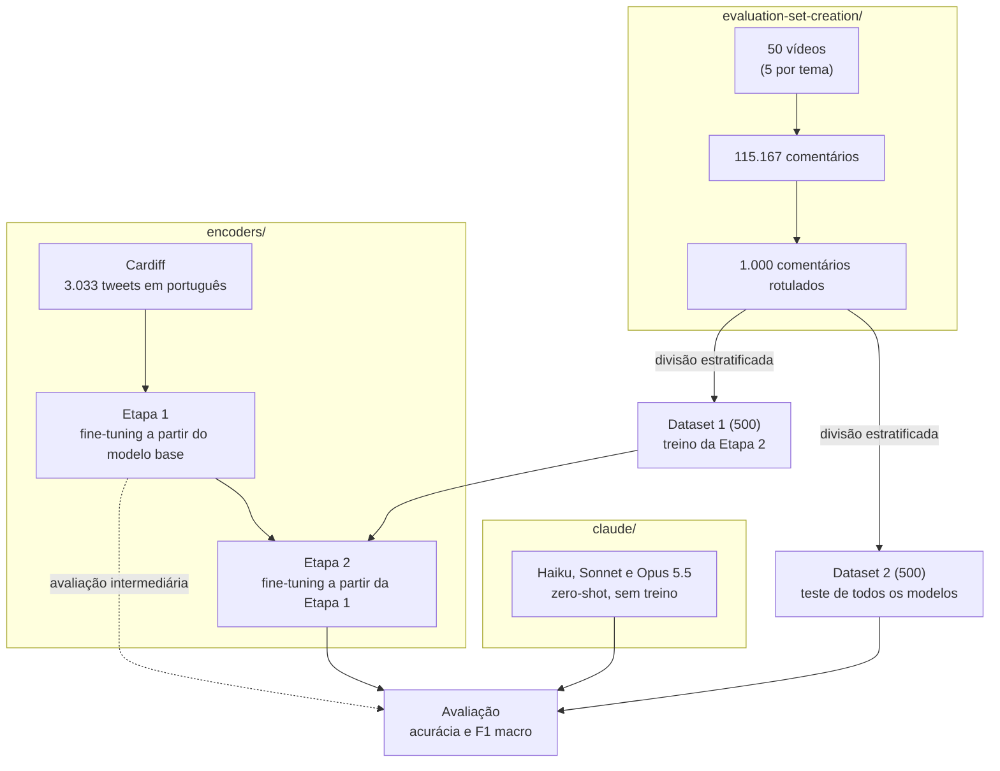

# Experimentos do TCC: classificação de sentimento em comentários do YouTube

Código, dados e procedimentos para reproduzir a parte experimental do trabalho. A tarefa
é classificar comentários do YouTube em português do Brasil como **negativo**,
**neutro** ou **positivo**, comparando encoders ajustados (fine-tuning) com LLMs em modo
zero-shot, no mesmo conjunto de teste.

## Desenho experimental



| Pasta | Etapa do trabalho | Conteúdo |
|---|---|---|
| [`evaluation-set-creation/`](evaluation-set-creation/README.md) | Construção do conjunto de dados | seleção dos vídeos, coleta, filtragem, sorteio e anotação dos 1.000 comentários |
| [`encoders/`](encoders/README.md) | Abordagem 1: fine-tuning | BERTimbau Large e Base, XLM-RoBERTa Base e DistilBERT multilíngue, ajustados em duas etapas |
| [`claude/`](claude/README.md) | Abordagem 2: zero-shot | Claude Haiku 5.5, Sonnet 5.5 e Opus 5.5 via API, sem treino |

Cada pasta é autocontida: tem seus próprios dados, `requirements.txt` e um README com o
passo a passo e os resultados obtidos. É possível reproduzir uma etapa sem as outras,
porque os dados que uma etapa recebe da anterior já estão versionados.

## Conjunto de dados

### Construção

O conjunto foi montado a partir de 50 vídeos publicados entre janeiro de 2025 e setembro
de 2026, 5 em cada uma de 10 categorias do YouTube, com no máximo um vídeo por canal.
De cada vídeo foram coletados todos os comentários de primeiro nível (115.167 no total).
Depois dos filtros de link, tamanho, duplicidade e idioma restaram 88.532, dos quais
foram sorteados 20 por vídeo, com semente fixa.

A anotação combinou dois procedimentos:

| Origem do rótulo final | Procedimento | Comentários |
|---|---|---|
| Amostra cega | dois anotadores humanos independentes, com adjudicação das 65 divergências | 200 |
| LLMs unânimes | GPT, DeepSeek e Gemini atribuíram o mesmo rótulo | 670 |
| LLMs divergentes | classificação manual, sem ver os rótulos das LLMs | 130 |

O Claude não participou da anotação, por ser um dos modelos avaliados. O procedimento
completo está no [`README`](evaluation-set-creation/README.md) da pasta, e a
justificativa e as referências, em
[`METODOLOGIA_DATASET.md`](evaluation-set-creation/METODOLOGIA_DATASET.md).

### Divisão em treino e teste

Os 1.000 comentários rotulados foram divididos em duas metades com a mesma proporção de
classes e sem comentários em comum:

| Conjunto | Uso | Negativos | Neutros | Positivos | Total |
|---|---|---|---|---|---|
| Dataset 1 | treino da Etapa 2 dos encoders | 122 | 153 | 225 | 500 |
| Dataset 2 | teste de todos os modelos | 122 | 153 | 225 | 500 |

Não há conjunto de validação. Os hiperparâmetros e o número de épocas foram fixados
antes do treino, e o dataset 2 só é usado na avaliação final.

### Arquivos

| Arquivo | Conteúdo |
|---|---|
| `evaluation-set-creation/reference/dataset_rotulado.csv` | os 1.000 comentários com metadados, rótulos de cada anotador e `rotulo_final` |
| `encoders/dataset/rotulos_finais.xlsx` | a mesma base de rotulagem em planilha, de onde saem os datasets 1 e 2 |
| `encoders/dataset/dataset1_finetuning.csv` | dataset 1 (`comment_id`, `text`, `sentimento`) |
| `encoders/dataset/dataset2_teste.csv` | dataset 2 (`comment_id`, `text`, `sentimento`) |
| `encoders/dataset/cardiff_tweets_ptbr_full.csv` | 3.033 tweets em português da Cardiff NLP, usados na Etapa 1 |
| `claude/dataset/dataset2_teste.csv` | cópia idêntica do dataset 2, para a pasta do Claude rodar sozinha |

## Abordagens comparadas

### Fine-tuning de encoders

Quatro encoders pré-treinados, escolhidos para cobrir modelos monolíngues e
multilíngues de tamanhos diferentes, recebem a mesma receita de treino:

| Etapa | Ponto de partida | Dados de treino | Objetivo |
|---|---|---|---|
| Etapa 1 | modelo base do Hugging Face | Cardiff: 3.033 tweets em português, 1.011 por classe | adaptar o modelo à tarefa num domínio próximo (rede social) |
| Etapa 2 | modelo da Etapa 1 | dataset 1: 500 comentários do YouTube | adaptar o modelo ao domínio-alvo |

Hiperparâmetros, tempos de treino e o procedimento de reprodução estão em
[`encoders/README.md`](encoders/README.md).

### Classificação zero-shot com Claude

Cada comentário é enviado numa chamada separada à API da Anthropic, com um prompt de
sistema que lista os três rótulos e pede só a palavra do rótulo. Não há exemplos no
prompt nem ajuste de parâmetros de amostragem. A configuração de raciocínio e esforço de
cada modelo, os custos e o tratamento de respostas inválidas estão em
[`claude/README.md`](claude/README.md).

## Protocolo de avaliação

- Todos os modelos são avaliados nos mesmos 500 comentários do dataset 2.
- **Métrica principal: F1 macro**, que dá o mesmo peso às três classes, já que a classe
  positiva é quase o dobro da negativa. Também são registrados acurácia, precisão e
  recall macro, relatório por classe e matriz de confusão.
- Para os encoders, as métricas do trabalho são as do `classificar_encoder.py`
  (inferência em fp32 sobre o modelo salvo).
- Para o Claude, as métricas são calculadas sobre as respostas válidas. Uma resposta é
  inválida quando não contém nenhum dos três rótulos.
- Também são medidos custo por comentário (Claude), latência, número de parâmetros e
  tamanho em disco (encoders).

## Resultados consolidados

| Modelo | Abordagem | Acurácia | F1 macro |
|---|---|---|---|
| Claude Opus 5.5 | zero-shot | 0,860 | 0,8463 |
| Claude Sonnet 5.5 | zero-shot | 0,838 | 0,8289 |
| Claude Haiku 5.5 | zero-shot | 0,833 | 0,8244 |
| BERTimbau Large | fine-tuning (Etapa 2) | 0,788 | 0,7799 |
| XLM-RoBERTa Base | fine-tuning (Etapa 2) | 0,784 | 0,7726 |
| BERTimbau Base | fine-tuning (Etapa 2) | 0,780 | 0,7658 |
| DistilBERT multilíngue | fine-tuning (Etapa 2) | 0,624 | 0,5902 |

### Efeito das etapas de fine-tuning

| Modelo | F1 macro após a Etapa 1 | F1 macro após a Etapa 2 | Ganho |
|---|---|---|---|
| BERTimbau Large | 0,7467 | 0,7799 | +0,033 |
| BERTimbau Base | 0,7297 | 0,7658 | +0,036 |
| XLM-RoBERTa Base | 0,7107 | 0,7726 | +0,062 |
| DistilBERT multilíngue | 0,4845 | 0,5902 | +0,106 |

### Custo e latência dos modelos Claude

| Modelo | Respostas válidas | Custo (500 comentários) | Latência média por chamada |
|---|---|---|---|
| Haiku 5.5 | 498 de 500 | US$ 0,0068 | 895 ms |
| Sonnet 5.5 | 500 de 500 | US$ 0,1365 | 1.095 ms |
| Opus 5.5 | 500 de 500 | US$ 0,3989 | 1.249 ms |

### Discussão

- Os três modelos Claude superaram todos os encoders sem nenhum exemplo de treino. A
  diferença entre o modelo Claude de menor desempenho (Haiku) e o melhor encoder
  (BERTimbau Large) foi de 4,4 pontos de F1 macro.
- A Etapa 2 melhorou todos os encoders, com ganho maior nos modelos que partiram de um
  desempenho mais baixo. Ajustar o modelo com comentários do próprio YouTube, mesmo que
  poucos (500), reduziu a diferença de domínio entre tweets e comentários.
- Entre os encoders, o BERTimbau Large, o XLM-RoBERTa Base e o BERTimbau Base ficaram
  próximos (F1 macro entre 0,766 e 0,780), uma diferença compatível com a variação entre
  execuções. O DistilBERT multilíngue ficou bem abaixo dos demais.
- O custo dos modelos Claude foi baixo para o tamanho do conjunto, mas cresce linearmente
  com o número de comentários e depende de um serviço externo. Os encoders, depois de
  treinados, rodam localmente sem custo por uso.

## Reprodução

### Ambiente

As pastas `encoders/` e `claude/` usam Python 3.12 com versões compatíveis entre si, e
uma venv única nesta pasta atende às duas:

```bash
cd scripts
python3.12 -m venv .venv
source .venv/bin/activate        # Linux/macOS
# .venv\Scripts\activate         # Windows
pip install torch==2.11.0 --index-url https://download.pytorch.org/whl/cu128   # só para encoders/
pip install -r encoders/requirements.txt -r claude/requirements.txt
```

A pasta `evaluation-set-creation/` fixa outra versão do `python-dotenv` e deve ter uma
venv própria, como descrito no README dela.

### Ordem de execução

| Ordem | Pasta | O que roda | Requisitos |
|---|---|---|---|
| 1 | `evaluation-set-creation/` | regenera o conjunto rotulado a partir dos dados brutos versionados | nenhum (roda offline) |
| 2 | `encoders/` | Etapa 1, Etapa 2 e classificação do dataset 2 | GPU NVIDIA com CUDA |
| 3 | `claude/` | estimativa de custo, piloto e classificação do dataset 2 | chave da API da Anthropic |

As etapas 2 e 3 são independentes entre si e não dependem da etapa 1 ter sido rodada,
porque os datasets 1 e 2 já estão versionados. Os comandos de `encoders/` e `claude/`
rodam de dentro da pasta de cada um.

### Variação entre execuções

| Etapa | Reprodução |
|---|---|
| Construção do conjunto | idêntica byte a byte a partir da pasta crua; uma coleta nova na API gera outro conjunto |
| Fine-tuning | seed 42, mas operações em GPU não são totalmente determinísticas; uma nova execução pode diferir em alguns comentários |
| Claude | os modelos não são determinísticos; predições, latência e custo podem variar levemente |

Os detalhes estão na seção "Variação esperada" de cada README.

## Relação com a aplicação web

O backend (`backend/`) não importa nenhum código desta pasta. Ele só lê os encoders que
o fine-tuning salva em `encoders/modelos/etapa2/` (caminho configurável em `MODELOS_DIR`
no `backend/.env`). Para os modelos Claude, o backend reproduz a configuração de
`claude/` (prompt, raciocínio, esforço e leitura da resposta) em
`backend/app/services/classificador_claude.py`.

## Arquivos não versionados

Ficam fora do Git: `.venv/`, `claude/.env` (chave da API) e tudo o que é gerado ao rodar
os experimentos, isto é, `encoders/modelos/` (vários GB), `encoders/resultados/`,
`encoders/cronometragem/`, `claude/resultados/` e os arquivos gerados dentro de
`evaluation-set-creation/dataset_validacao/`. As predições e métricas de cada modelo são
geradas seguindo o README de cada pasta, e a versão de referência do conjunto de dados
fica em `evaluation-set-creation/reference/`.
